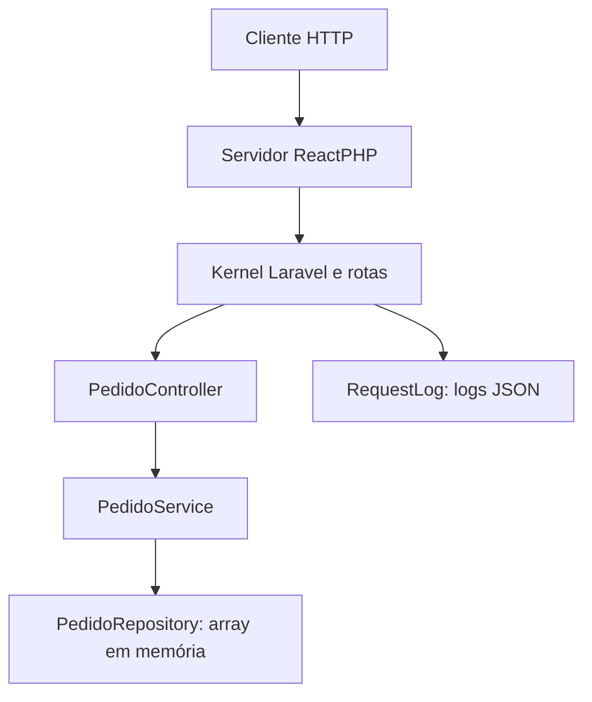

# CP5 SOA - API de pedidos

API REST em **PHP 8.2+ e Laravel 12**, com armazenamento de pedidos exclusivamente em memória, documentação OpenAPI, testes PHPUnit e logs estruturados em JSON.

## Integrantes

| Nome | RM |
| --- | --- |
| Douglas dos Santos Melo | PREENCHER |

Preencha o RM e acrescente os demais integrantes antes da entrega.

## Executar

Pré-requisitos: PHP 8.2 ou superior, Composer 2 e extensões exigidas pelo Composer (incluindo mbstring, DOM/XML e cURL). Não precisa de Node, banco de dados ou Docker.

```bash
composer install
```

Copie `.env.example` para `.env` (pelo editor ou explorador de arquivos). Depois:

```bash
php artisan key:generate
php artisan api:serve
```

A API estará em `http://127.0.0.1:8000`. Encerre com Ctrl+C.

**Use `api:serve` para esta atividade.** Esse comando mantém um processo ativo com ReactPHP e encaminha as requisições ao kernel HTTP do Laravel. O array de pedidos pertence a um repositório singleton e permanece disponível entre chamadas. `php artisan serve` reinicializa o estado PHP a cada requisição e não preserva esse array.

Os pedidos são apagados ao reiniciar o processo. Há apenas uma instância em memória; executar vários processos cria armazenamentos independentes. A solução foi limitada à demonstração acadêmica local.

Porta alternativa:

```bash
php artisan api:serve --port=8080
```

## Arquitetura



- **Servidor ReactPHP:** recebe HTTP em um processo contínuo e adapta cada chamada para uma nova Request do Laravel.
- **Kernel e rotas:** executam os middlewares e direcionam cada operação ao controller.
- **PedidoController:** valida o JSON e os dados de entrada; monta as respostas e os códigos HTTP.
- **PedidoService:** coordena os casos de uso de criação e consulta.
- **PedidoRepository:** gera UUID, aplica o status inicial `CRIADO` e guarda os pedidos no array. É singleton dentro do processo.
- **RequestLog:** registra método, caminho, status, requestId e pedidoId quando disponível.

## Operações

| Método | Caminho | Resultado |
| --- | --- | --- |
| POST | `/api/pedidos` | Cria um pedido (201) |
| GET | `/api/pedidos/{id}` | Consulta um pedido (200 ou 404) |

Entradas inválidas retornam 422; JSON malformado, 400; conteúdo que não é JSON, 415. As respostas da API usam JSON. IDs são gerados no servidor, e o cliente não escolhe o status inicial.

O valor deve ser positivo, ter no máximo duas casas decimais e não ultrapassar 999999999,99. Na resposta, ele é uma string decimal com duas casas. Cliente e descrição são obrigatórios, com limites de 120 e 500 caracteres. Espaços nas extremidades são removidos pelo middleware padrão do Laravel.

### Criar pedido

No Postman, envie `POST http://127.0.0.1:8000/api/pedidos`, com `Content-Type: application/json` e este corpo:

```json
{"cliente":"Douglas Melo","descricao":"Teclado mecânico","valor":199.90}
```

Exemplo equivalente no terminal (no Windows, utilize `curl.exe` e ajuste as aspas para seu terminal):

```bash
curl -i -X POST http://127.0.0.1:8000/api/pedidos -H 'Content-Type: application/json' -H 'Accept: application/json' -d '{"cliente":"Douglas Melo","descricao":"Teclado mecânico","valor":199.90}'
```

Resposta ilustrativa, HTTP 201, com `Location: /api/pedidos/{id}` e `X-Request-Id`:

```json
{"id":"b7e8b248-a963-4b9c-a126-bb2505a40aca","cliente":"Douglas Melo","descricao":"Teclado mecânico","valor":"199.90","status":"CRIADO"}
```

### Consultar pedido

Utilize o ID efetivamente recebido na criação:

```bash
curl -i http://127.0.0.1:8000/api/pedidos/SEU_ID -H 'Accept: application/json'
```

HTTP 200 retorna o mesmo objeto. Um identificador inexistente retorna HTTP 404:

```json
{"message":"Pedido não encontrado."}
```

## OpenAPI

A especificação completa está em [docs/openapi.json](docs/openapi.json). Importe o arquivo no Swagger Editor ou no Postman para visualizar as duas operações, esquemas e erros. A atividade não exige Swagger UI em execução.

## Testes automatizados

```bash
composer test
```

Também é possível executar diretamente:

```bash
php vendor/bin/phpunit --testdox
```

Os testes verificam criação e consulta do mesmo pedido, ID inexistente, dados inválidos, unicidade dos IDs, JSON malformado e Content-Type incorreto. Cada teste inicializa uma aplicação isolada, sem dependência de banco externo.

### Evidência de execução

Saída real de `php vendor/bin/phpunit --testdox --colors=never`, com PHP 8.3.30 e Laravel 12.70.1:

```text
PHPUnit 11.5.57 by Sebastian Bergmann and contributors.

Runtime:       PHP 8.3.30
Configuration: /workspace/scratch/a8014ca02708/cp5-soa-laravel/phpunit.xml

......                                                              6 / 6 (100%)

Time: 00:00.214, Memory: 30.00 MB

Pedido (Tests\Feature\Pedido)
 ✔ Cria e consulta o mesmo pedido
 ✔ Pedido inexistente retorna 404
 ✔ Dados invalidos retornam 422
 ✔ Pedidos possuem ids distintos
 ✔ Json malformado retorna 400
 ✔ Formulario retorna 415

OK (6 tests, 28 assertions)
```

O registro também está em [docs/tests-evidence.txt](docs/tests-evidence.txt).

O teste adicional por HTTP confirmou criação de dois pedidos, IDs distintos, consulta dos dois entre requisições independentes, erro de validação, consulta inexistente e perda dos pedidos após reiniciar. Saída registrada em [docs/http-evidence.txt](docs/http-evidence.txt).

## Logs estruturados

Gerados em `storage/logs/laravel.log`, uma linha JSON por registro. O campo `datetime` representa o timestamp; `level_name`, o nível; `message`, a operação; e `context`, os identificadores e detalhes HTTP. O `requestId` também é devolvido no cabeçalho `X-Request-Id`.

### Evidência de log gerado

Linha real produzida durante a criação de um pedido pelo servidor HTTP:

```json
{"message": "pedido.http", "context": {"requestId": "ebfeeaeb-2194-4884-95af-9a45b9d071f6", "pedidoId": "a95c417f-2b79-4bb8-a0e7-d6bf6e11104e", "method": "POST", "path": "api/pedidos", "status": 201}, "level": 200, "level_name": "INFO", "channel": "local", "datetime": "2026-10-22T00:29:46.586505+00:00", "extra": {}}
```

Mais registros em [docs/logs-evidence.jsonl](docs/logs-evidence.jsonl).

## Referências

- [Documentação oficial do Laravel 12](https://laravel.com/docs/12.x)
- [Servidor HTTP ReactPHP](https://reactphp.org/http/)

## Entrega

Repositório público: https://github.com/doug-melo/CP5-SOA. Não envie `.env` ou `vendor/`. O `composer.lock` está incluído para reproduzir as dependências validadas. Preencha os participantes e RMs e entregue o link do repositório na tarefa da disciplina.
